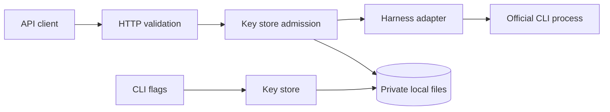

# Architecture

## Problem

h2a gives an application limited access to a locally authenticated coding harness. The gateway owns authentication and admission; the official CLI owns the provider login and inference. A sandbox receives a gateway key, not the provider credentials.

The implementation stays a Go binary with standard-library HTTP serving and local files. It supports one running server per state directory. It is not a distributed quota service.

## Usage (caller's view)

The API caller supplies a bearer key and a model to `/v1/chat/completions`. Both streaming and ordinary responses use the same admission path. A rejected request never starts a harness.

The server's internal flow is deliberately short:

```go
lease, err := admission.Admit(request.Context(), bearer, model)
if err != nil {
    // Translate a typed denial into a sanitized API error.
    return
}
defer lease.Close()
usage, err := adapter.Run(lease.Context(), input, emit)
```

The lease remains active until the adapter has returned, including the streaming worker. An accepted request is counted before the adapter starts. Failure, cancellation, and disconnect do not refund the request.

## Shape



| Owner | Responsibility |
| --- | --- |
| `cmd/h2a` | Parse flags, construct the server, inspect local policy, and run explicit HTTP probes. |
| `internal/auth` | Key hashes, policy, durable usage, cross-process locking, admission leases, and cancellation. |
| `internal/api` | Bounded request parsing, configured model rules, OpenAI-shaped responses, and SSE. |
| `internal/harness` | CLI arguments, filtered assistant output, reported usage, and subprocess cancellation. |

Policy and usage belong in the same key record so admission can update them atomically. A stable transaction lock coordinates server writes with separate CLI commands. An independent server-lifetime lock prevents two gateways from maintaining competing in-memory concurrency counts. Lock files are not removed or replaced.

The effective deadline is the earliest of the caller deadline, server timeout, key timeout, and absolute key expiry. A watcher observes revoked or unreadable active keys and cancels their contexts. Cancellation reaches the existing adapter process runner; accounting does not depend on receiving final provider usage.

The API owns model-name validation because it knows which adapters and names are configured. The CLI uses the same pure rules for local explanations. An explicit configured name is not evidence of account access. A live probe goes through the actual authenticated HTTP endpoint, so it cannot bypass quota or authorization.

## Synthesis decision

Two designs were compared: extend the existing key store with admission leases, or create a separate runtime/accounting package. The key-store design is the base. It keeps record ownership, revocation, and quota mutation in one package. From the separate-runtime design, admission also takes ownership of global capacity so HTTP callers cannot accidentally reserve only one of the required limits.

The separate runtime would require a shared storage/lock protocol across packages and additional accounting files. That exposes more implementation rules to callers without improving the first-release experience. We also rejected mandatory manual recovery after every unclean shutdown: concurrency limits describe runs managed by the current server, not every provider process that might survive a force-kill.

The independent design comparison also preferred the single-store design on interface depth and ownership. Its useful additions were readable duration fields and explicit denial codes. The final implementation puts deadline and accounting decisions behind `Admit`; it does not retain a separate reserve/commit/release protocol for callers to coordinate.

## Tradeoffs accepted

- We accept one server per local state directory in exchange for avoiding distributed coordination and another service.
- We accept a durable file update per admitted request in exchange for preserving request quotas across restarts.
- We count a request even if the server stops between its durable debit and subprocess start. A conservative debit is preferable to an uncounted run.
- We accept polling delay for revocation rather than introducing filesystem-watcher dependencies. Cancellation initiation is not a hard real-time guarantee.
- We preserve unlimited legacy keys unless an operator replaces them with bounded keys. No migration silently changes existing access.
- We validate configured model names, not an invented upstream catalog. Provider aliases may still change their underlying model.

## Operational limits

Use a private local filesystem with working file locks and atomic replacement. Separate state directories have separate quotas. Restoring old state can restore old counters; an administrator who controls the files controls the policy.

Normal cancellation and graceful shutdown stop managed runs. A forcibly killed gateway can leave orphaned harness processes; check and stop those before treating a restarted server's concurrency limit as a cap on all machine activity. Windows subprocess cancellation currently targets the direct child, not an entire descendant process tree.

Stopping a local CLI does not prove the upstream service stopped computation or refunded subscription usage. Missing provider token usage remains unknown. This release enforces accepted request counts and local runtime controls, not exact dollar budgets or upstream token spending.

Linux and macOS use advisory file locks, file synchronization, atomic rename, and directory synchronization. Windows uses native `LockFileEx` and a flushed temporary file followed by a write-through replacement. Revocation first moves the Windows record out of the active namespace; a crash can leave an ignored `.revoked-*` tombstone. Windows builds and tests cross-compile, but native Windows execution must be verified in CI. Its write-through move is not a claim of POSIX directory-sync semantics.

## Extension rule

Add a new constraint to the existing admission operation and its behavioral tests. Do not add a second quota check in a handler, a separate probe execution path, or a second writer of key records. Add provider-specific behavior behind the existing adapter interface.
